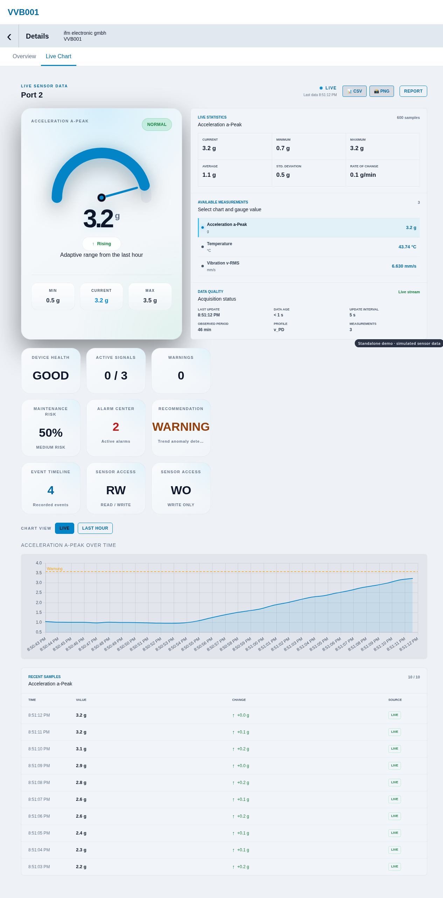
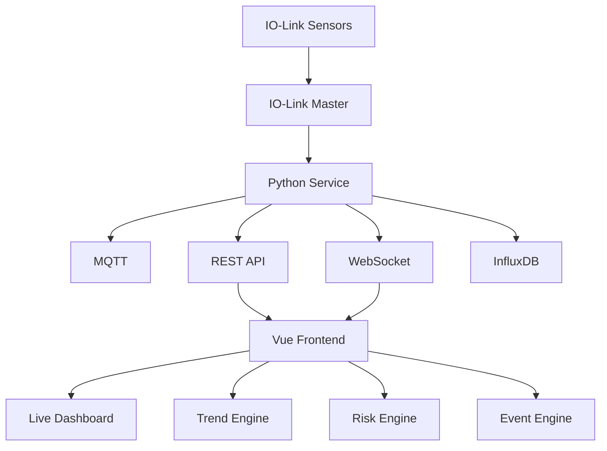
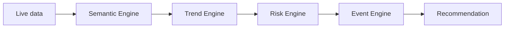
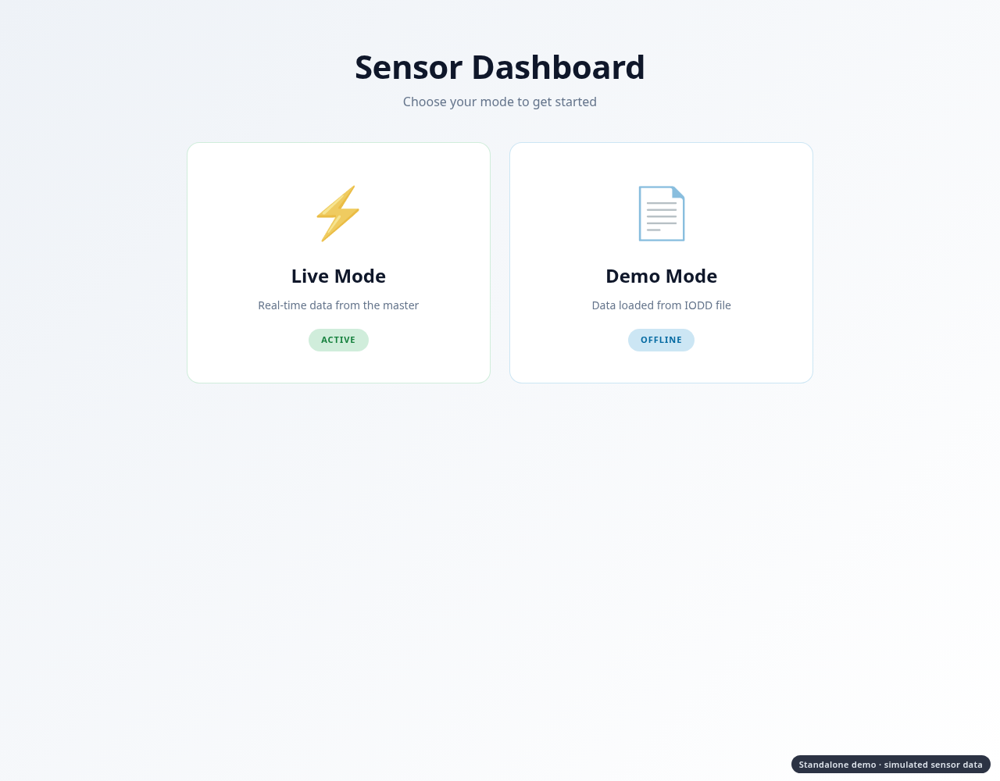
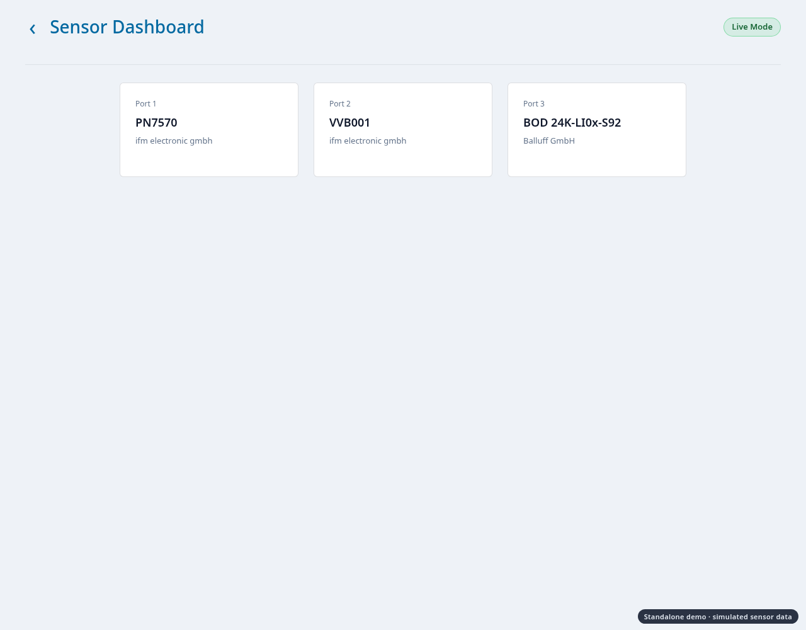
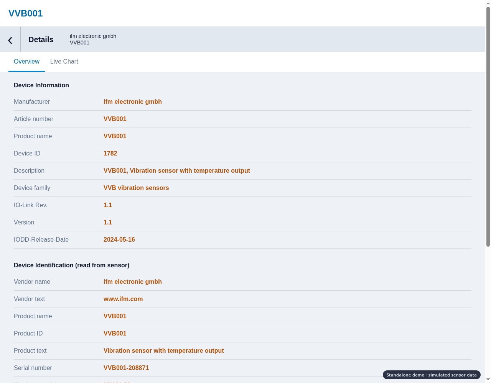

# IO-Link Sensor Dashboard with Predictive Maintenance

**Diploma thesis, HTL BULME Graz (2026):** *Intelligente Sensorvisualisierung und Predictive Maintenance mit IO-Link*

A web dashboard that shows industrial IO-Link sensors in real time and turns their raw process data into
readable states, trends and maintenance recommendations.

> **My part: the complete frontend** (Vue 3 dashboard, live visualisation and the analysis logic in the browser).
> The backend (Python service, MQTT, InfluxDB) was built by my team partner Martin Orthacker.



---

## Try it in 10 seconds

Open **[demo/frontend-demo.html](demo/frontend-demo.html)** in any modern browser. No installation, no server, no sensor hardware.

It is the real, unchanged frontend with a simulated backend (three sensors, one hour of history, a live stream every second).
About 45 seconds after loading, the vibration sensor on **Port 2** starts to drift: you can watch the trend detection,
the maintenance risk, the alarm center and the event timeline react.

| Step | What to look at |
|---|---|
| Home | Choose **Live Mode** (WebSocket stream) or **Demo Mode** (stored history, no master needed) |
| Sensor list | Port 1 pressure (ifm PN7570), Port 2 vibration/temperature (ifm VVB001), Port 3 laser distance (Balluff BOD) |
| Overview | IODD metadata plus identification data read from the sensor |
| Live Chart | Gauge, statistics, trend, risk, alarms, events, chart, CSV/PNG export |

The simulated data is for demonstration only; the demo source is in [demo/source](demo/source).

---

## What the frontend does

* **Live monitoring:** process data arrives over WebSocket; if the stream stops, the dashboard switches to the stored InfluxDB values automatically (history fallback).
* **Generic by design:** sensor structure comes from the IODD file, so one dashboard works for different sensors (pressure, vibration, distance, switching outputs) without sensor-specific code.
* **Rule-based analysis in the browser:** four small engines, each with one job.
  * *Semantic engine:* gives each value a meaning (temperature, pressure, vibration, distance, switching signal).
  * *Trend engine:* rising, falling, stable, fast change, unstable.
  * *Risk engine:* maps trend and sensor type to a risk level and a maintenance recommendation.
  * *Event engine:* alarm handling with deduplication and recovery detection.
* **Special values:** IO-Link codes such as OL / UL / NoData are recognised and not drawn as measurements.
* **Parameter access:** read and write sensor parameters through the master, with validation and read-back verification (disabled in Demo Mode).
* **Export:** CSV and PNG of the current view.

The analysis is deliberately **rule-based, not machine learning**: transparent, explainable and easy to test.

---

## Architecture



### Frontend pipeline



---

## Screenshots (from the demo)

| | |
|---|---|
|  |  |
| Mode selection | Sensor list |
|  |  |
| Sensor overview (IODD + identification) | Live chart with risk analysis |

---

## Technologies

| Area | Used |
|---|---|
| Frontend (my part) | Vue 3, Vite, Vue Router, Chart.js (vue-chartjs), CoreUI styles, html2canvas, PWA support |
| Backend (team partner) | Python, FastAPI, Paho MQTT, InfluxDB, MongoDB |
| Communication | REST, WebSocket, MQTT (Mosquitto), IO-Link |

---

## Run the full system

The complete project (frontend, Python service, documentation) is in the team repository.

```bash
# Frontend
cd frontend
npm install
npm run dev          # http://localhost:5173
```

The live mode needs the Python service, an MQTT broker and InfluxDB; see the team repository for the full startup sequence.

---

## Authors

* **Frontend:** Viktor Borosnyai
* **Backend:** Martin Orthacker
* **Supervisors:** Prof. DI Stefan Kummer, BEd; DI Thomas Kainz, BSc

License: MIT
